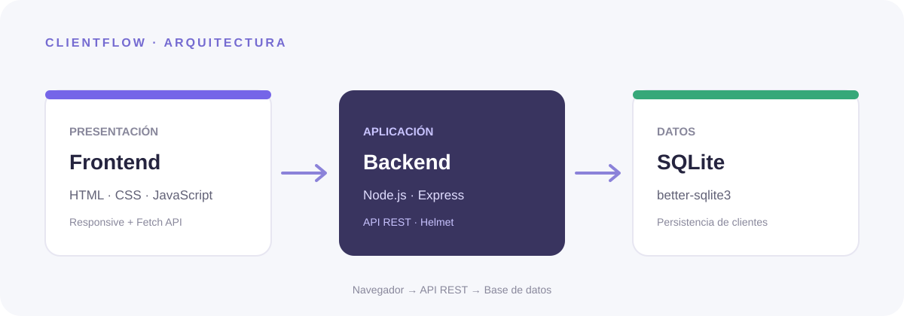

# ClientFlow — CRM Full Stack


**ClientFlow** es una aplicación web Full Stack para organizar una cartera de clientes desde un panel de control. Permite registrar contactos, consultar oportunidades comerciales y mantener actualizada la información de cada cliente.

> Proyecto de portfolio desarrollado por **Marcos Santos** para demostrar habilidades de frontend, backend, diseño de API REST y persistencia de datos.

## Arquitectura



## Captura de la aplicación

Guarda una captura real del panel en `docs/screenshots/clientflow-dashboard.png` y añade esta línea cuando hayas creado el archivo:

``

## Funcionalidades

- **Dashboard:** resumen de clientes, clientes activos, prospectos y nuevos contactos.
- **CRUD de clientes:** crear, consultar, editar y eliminar registros.
- **Búsqueda:** localizar clientes por nombre, correo electrónico o empresa.
- **Filtros:** mostrar clientes por estado comercial.
- **Validación en backend:** comprobación de campos y control de correos duplicados.
- **Persistencia:** almacenamiento de datos con SQLite.
- **Diseño responsive:** interfaz adaptable a escritorio, tablet y móvil.
- **API REST:** endpoints independientes para clientes y estadísticas.

## Tecnologías

| Área | Tecnologías |
|---|---|
| Frontend | HTML5, CSS3, JavaScript |
| Backend | Node.js, Express |
| Base de datos | SQLite, better-sqlite3 |
| Comunicación | API REST, Fetch API |
| Seguridad básica | Helmet, validación de entradas |
| Control de versiones | Git, GitHub |

## Ejecutar el proyecto en local

### Requisitos
- Node.js 22 o superior.
- npm.

### Instalación

```bash
git clone https://github.com/Marcos-3019/gestor-clientes-fullstack.git
cd gestor-clientes-fullstack
npm install
```

Crea `.env` desde `.env.example`:

**Windows PowerShell**
```powershell
Copy-Item .env.example .env
```

**macOS / Linux**
```bash
cp .env.example .env
```

Inicia el servidor:

```bash
npm run dev
```

Abre [http://localhost:3000](http://localhost:3000). Para iniciar en modo normal usa `npm start`.

La base de datos se crea automáticamente. En una instalación nueva se insertan tres clientes ficticios de demostración.

## API REST

| Método | Endpoint | Descripción |
|---|---|---|
| `GET` | `/api/health` | Comprueba el estado del servicio |
| `GET` | `/api/stats` | Devuelve las métricas del dashboard |
| `GET` | `/api/clients` | Lista los clientes |
| `GET` | `/api/clients?search=ana` | Busca por nombre, email o empresa |
| `GET` | `/api/clients?status=active` | Filtra por estado |
| `POST` | `/api/clients` | Crea un cliente |
| `PUT` | `/api/clients/:id` | Actualiza un cliente |
| `DELETE` | `/api/clients/:id` | Elimina un cliente |

### Ejemplo de `POST /api/clients`

```json
{
  "name": "Ana García",
  "email": "ana@empresa.com",
  "company": "Empresa Demo",
  "phone": "600 000 000",
  "status": "lead",
  "notes": "Contactar la próxima semana"
}
```

Estados permitidos: `lead`, `prospect` y `active`.

## Despliegue en Railway

La aplicación lee el puerto desde `process.env.PORT` y la ruta de la base de datos desde `DB_FILE`.

Para conservar los datos entre despliegues:

1. Crea un proyecto en [Railway](https://railway.com/) y despliega desde `Marcos-3019/gestor-clientes-fullstack`.
2. En el servicio de la aplicación, añade un **Volume** con punto de montaje `/data`.
3. En **Variables**, añade `DB_FILE` con el valor `/data/clients.db`.
4. Comprueba que el comando de inicio sea `npm start`.
5. En **Settings → Networking**, genera un dominio público.
6. Abre el dominio HTTPS y comprueba el dashboard y las operaciones de clientes.

**Importante:** el fichero SQLite debe estar en el volumen persistente `/data`, no en el sistema de archivos efímero del contenedor. No subas `.env`, datos reales ni secretos al repositorio.

Documentación:
- [Guía oficial de Railway para Express](https://railway.com/guides/express)
- [Volúmenes persistentes de Railway](https://docs.railway.com/volumes/reference)
- [Precios de Railway](https://railway.com/pricing)

## Estructura

```text
gestor-clientes-fullstack/
├── docs/
│   └── architecture.svg
├── public/
│   ├── app.js
│   ├── index.html
│   └── styles.css
├── data/                 # Se crea automáticamente; no se versiona
├── .env.example
├── .gitignore
├── database.js
├── package-lock.json
├── package.json
├── README.md
├── server.js
└── validation.js
```

## Mejoras previstas

- Autenticación y roles de usuario.
- Tests automatizados de API.
- Exportación de clientes a CSV.
- Registro de actividad y seguimiento comercial.

## Autor

**Marcos Santos** · [GitHub @Marcos-3019](https://github.com/Marcos-3019)

Repositorio: [gestor-clientes-fullstack](https://github.com/Marcos-3019/gestor-clientes-fullstack)

---

*Proyecto demostrativo. Los datos iniciales son ficticios. No introduzcas información personal real en una demo pública.*
